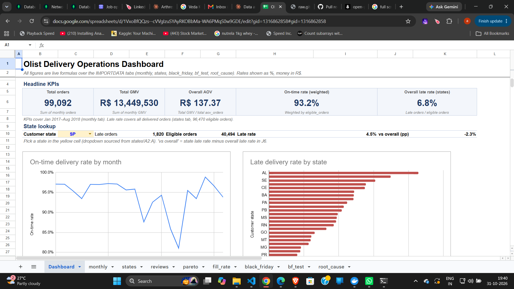

# olist-delivery-analytics

SQL analysis of delivery performance in the Olist Brazilian e-commerce dataset,
approached the way a quick-commerce operations analyst would: how long orders
take, how often the delivery promise is missed, and which data can be trusted
to answer that.

Stack: Python 3.13, DuckDB, SciPy, pytest, GitHub Actions, Google Sheets.

- Phase 1: load and validate the data ([DATA_QUALITY.md](DATA_QUALITY.md)).
- Phase 2: answer delivery and business questions in SQL and export small
  aggregated tables for a Google Sheets dashboard
  ([FINDINGS.md](FINDINGS.md)).

## Dashboard

[Olist Delivery Operations Dashboard (Google Sheets)](https://docs.google.com/spreadsheets/d/1VxoBfQQzs--cVVgIzuSYAyRKOBbMa-WA6PMqS0w9GDE/edit?usp=sharing)



## Layout

```
data/raw/            Olist CSVs (gitignored, never committed)
data/exports/        Aggregated CSVs for Google Sheets (generated, committed)
scripts/load.py      Loads the CSVs into olist.duckdb as raw_ tables, builds the views
scripts/checks.py    Registry of data-quality checks and the decision for each
scripts/quality_report.py   Runs the checks on the full data and writes DATA_QUALITY.md
scripts/export.py    Runs every analysis query and writes data/exports/
scripts/significance.py     Black Friday significance test (Mann-Whitney U)
scripts/run_all.py   Load, quality report and exports in one command
sql/01_staging.sql   Staging views (stg_*)
sql/02_analysis_base.sql    Shared analysis views (int_orders, int_months, int_black_friday_periods)
sql/analysis/        One analysis query per file, one export per file
sql/stats/           Row-level sample for the significance test (not exported)
sql/checks/          One SQL file per data-quality check
tests/               pytest suite, run against tests/fixtures/ (synthetic data)
DATA_QUALITY.md      Generated: real counts for every check, and the decision taken
FINDINGS.md          Insights from the real data, each linked to its query
```

## Setup and run (Windows PowerShell)

From the repository root, with the Olist CSVs in `data/raw/`:

```powershell
# 1. Create the virtual environment and install dependencies
py -3.13 -m venv .venv
.\.venv\Scripts\python.exe -m pip install --upgrade pip
.\.venv\Scripts\python.exe -m pip install -r requirements.txt

# 2. Load the data into olist.duckdb (prints row counts per table)
.\.venv\Scripts\python.exe scripts\load.py

# 3. Run the tests (synthetic fixture; does not need data/raw)
.\.venv\Scripts\python.exe -m pytest

# 4. Regenerate DATA_QUALITY.md from the full data
.\.venv\Scripts\python.exe scripts\quality_report.py

# 5. Write the Google Sheets exports to data\exports\
.\.venv\Scripts\python.exe scripts\export.py
```

Steps 2, 4 and 5 run in one command. To refresh the dashboard, run it and push:

```powershell
.\.venv\Scripts\python.exe scripts\run_all.py
git add data\exports DATA_QUALITY.md
git commit -m "Refresh exports"
git push
```

To print just the Black Friday significance test:
`.\.venv\Scripts\python.exe scripts\significance.py`

Calling `.venv\Scripts\python.exe` directly avoids PowerShell's script execution
policy. To activate the venv instead, run
`Set-ExecutionPolicy -Scope CurrentUser RemoteSigned` once, then
`.\.venv\Scripts\Activate.ps1`.

## Loading

`scripts/load.py` loads every Olist CSV except `olist_geolocation_dataset.csv`.
Every column has an explicitly declared type rather than a guessed one; guessing
would turn zip prefixes such as `01037` into the integer `1037`. Timestamps are
parsed as `%Y-%m-%d %H:%M:%S`.

The loader never drops rows silently. It fails, and leaves any previous
database untouched, if:

- a CSV header differs from the expected columns,
- a timestamp does not parse (it never becomes NULL), or
- DuckDB loads a different number of rows than Python's `csv` module counts in the file.

## Delivery metrics

`stg_orders` keeps every order and adds:

| Column | Definition |
|---|---|
| `delivery_days` | Purchase timestamp to customer delivery timestamp, in **fractional days rounded to 2 decimals** (e.g. 4 days 6 hours = 4.25). |
| `estimated_days` | Purchase timestamp to the estimated delivery date, same unit. |
| `is_late` | Delivered on a **later calendar date** than the estimated date: `delivered::DATE > estimated::DATE`. |
| `exclusion_reason` | NULL when the order is eligible for delivery metrics; otherwise why it is not. |
| `is_delivery_metric_eligible` | `exclusion_reason IS NULL`. |

The three metrics are filled only for eligible orders, so an aggregate over
`stg_orders` cannot accidentally include a bad row.

**Why `is_late` compares dates.** Olist stores every estimated delivery date at
`00:00:00`, so it is a date, not a deadline with a time. Comparing timestamps
would mark any order delivered during the promised day as late. On the full
data, a timestamp comparison flags 7,826 late orders, while the date comparison
flags 6,534. The difference is 1,292 orders delivered on the promised day.

**Why fractional days.** Whole-day counts round a 25-hour delivery and a
47-hour delivery to the same number. Fractional days keep that difference for
averages and percentiles. Two decimals is about 15 minutes of precision.

**Exclusions.** Only delivered orders with valid dates count. Every other order
gets exactly one reason (first match wins): `duplicate_order_id`,
`status_not_delivered`, `missing_purchase_date`, `missing_delivered_date`,
`missing_estimated_date`, `delivered_before_purchase`.
`stg_delivery_exclusions` counts orders per reason. `v_delivery_reconciliation`
checks that raw rows = staged rows = eligible + excluded.

## Analysis (Phase 2)

Each file in `sql/analysis/` answers one question. It starts with a comment
giving the question, the metric definitions and any volume threshold.
`scripts/export.py` runs the files in order and writes
`data/exports/<file name>.csv`. Questions that need two levels of detail are
split into `a` and `b` files.

| Query | Business question |
|---|---|
| [01_monthly_kpis](sql/analysis/01_monthly_kpis.sql) | Monthly orders, GMV, AOV, average and median delivery days, on-time rate |
| [02_wow_delivery_by_state](sql/analysis/02_wow_delivery_by_state.sql) | Week-over-week change in average delivery days by customer state (`LAG()`); flags the 5 states with the largest jump |
| [03a_sla_breach_by_customer_state](sql/analysis/03a_sla_breach_by_customer_state.sql) | Late-delivery (SLA breach) rate by customer state |
| [03b_sla_breach_by_seller](sql/analysis/03b_sla_breach_by_seller.sql) | Late-delivery rate by seller, ranked within the seller's state (`RANK()`) |
| [04_reviews_late_vs_on_time](sql/analysis/04_reviews_late_vs_on_time.sql) | Review score and share of 1-2 star reviews, late vs on-time orders |
| [05_category_pareto](sql/analysis/05_category_pareto.sql) | Categories by GMV with a cumulative share (`SUM() OVER`) |
| [06_repeat_customers](sql/analysis/06_repeat_customers.sql) | Share of customers with more than one order, and their share of GMV |
| [07a_fill_rate_by_month](sql/analysis/07a_fill_rate_by_month.sql) | Canceled and unavailable share of orders by month (fill-rate proxy) |
| [07b_fill_rate_by_category](sql/analysis/07b_fill_rate_by_category.sql) | The same by product category |
| [08a_dispatch_sla_by_seller](sql/analysis/08a_dispatch_sla_by_seller.sql) | Share of items handed to the carrier after the seller's shipping deadline, by seller |
| [08b_dispatch_sla_by_seller_state](sql/analysis/08b_dispatch_sla_by_seller_state.sql) | The same by seller state |
| [09_black_friday](sql/analysis/09_black_friday.sql) | Black Friday 2017 vs the 4 weeks before: daily orders, GMV, AOV, delivery days, late rate |
| `09b` ([significance.py](scripts/significance.py)) | Is the change in delivery days beyond chance? Mann-Whitney U, with effect size |
| [10_late_root_cause](sql/analysis/10_late_root_cause.sql) | Which stage (approval, seller dispatch, carrier transit) makes late orders late, overall and in the states flagged by 02 |
| [11_delivery_tail_by_month](sql/analysis/11_delivery_tail_by_month.sql) | Is the late-window improvement real or right-censoring? Delivery-day percentiles (median, p90, p99), open-order share and observation window by month |

### Metric definitions

| Metric | Definition |
|---|---|
| Orders | Distinct orders placed, any status, bucketed by `order_purchase_timestamp`. |
| GMV order | An order whose status is neither `canceled` nor `unavailable`. |
| **GMV** | Sum of `order_items.price` over GMV orders. **Freight is excluded.** |
| **AOV** | GMV / number of GMV orders **with at least one item** (`aov_orders` in 01 and 09). A GMV order with no items has no basket, so it is left out of the denominator. There are 8 such orders on the real data (5 `created`, 2 `invoiced`, 1 `shipped`). |
| Delivery days, late, on time | `delivery_days` and `is_late` come from `stg_orders` and are never re-derived. They cover delivery-eligible orders only (`is_delivery_metric_eligible`). On-time rate = share of eligible orders with `is_late = false`. Late rate (SLA breach rate) = the rest. |
| Review metrics | Latest review per order only (`is_latest_for_order`). Orders without a review are counted in `orders_without_review` and never scored. Low-score share = reviews of 1 or 2 stars / reviewed orders (order defect proxy). |
| Repeat customer | A `customer_unique_id` with more than one GMV order. `customer_id` is issued per order, so it cannot identify a returning customer. |
| Fill-rate proxy | (canceled + unavailable orders) / all orders. The fill rate is 1 minus this. |
| Dispatch SLA | Share of order items whose order was handed to the carrier after the item's `shipping_limit_date`. Compared as timestamps, because the deadline has a real time of day. |
| Delivery stages | Approval = purchase to `order_approved_at`. Dispatch = approval to carrier handover. Transit = carrier handover to customer delivery. All in fractional days; they add up to the delivery time. |

### Trend window and excluded months

Trend views (01, 02, 07a, 11) use only complete months. `int_months` lists every
calendar month from the first purchase to the last, including empty ones. A
month qualifies if its orders are at least 10% of the median month's orders.
The trend window is the longest unbroken run of qualifying months.

On the full data the trend window is **2017-01 to 2018-08**. Excluded months:

| Month | Orders | Reason |
|---|---|---|
| 2016-09 | 4 | below volume threshold |
| 2016-10 | 324 | below volume threshold |
| 2016-11 | 0 | below volume threshold (no orders at all) |
| 2016-12 | 1 | below volume threshold |
| 2018-09 | 16 | below volume threshold |
| 2018-10 | 4 | below volume threshold |

`scripts/export.py` prints this list on every run, so you'll see if a reload
with different data changes it.

**Right-censoring at the end of the window.** An order still in transit when
the data was extracted hasn't been delivered, so it isn't eligible for
delivery metrics. The last months of the window can therefore be missing their
slowest deliveries, which biases delivery days down and the on-time rate up.
Query 11 measures how far this can go. Censored orders are a subset of each
month's open orders (`open_order_share`), and only deliveries slower than
`min_days_observable` can be hidden. So the effect is limited to the extreme
tail; FINDINGS.md has the numbers.

### Volume thresholds

Every per-group rate or ranking needs a minimum volume. Each threshold is
written in its query as `coalesce(getvariable('<name>'), <default>)` and
explained in the header comment. The fixture is tiny, so the tests lower the
thresholds with `SET VARIABLE`; production runs use the defaults.

| Variable | Default | Used by |
|---|---|---|
| `min_month_share_of_median` | 0.10 | `int_months` (trend window) |
| `min_state_week_orders` | 30 eligible orders, in the week and in the week before | 02 |
| `min_state_orders` | 30 eligible orders | 03a |
| `min_seller_orders` | 30 eligible orders | 03b |
| `min_category_orders` | 30 orders | 07b |
| `min_seller_items` | 30 handed-over items | 08a |
| `min_seller_state_items` | 30 handed-over items | 08b |

Query 05 has no threshold: GMV is a total, not a rate, so a small category is
small rather than noisy.

### Data handling decisions

- **Duplicated order_ids** are left out of all Phase 2 analysis (`int_orders`),
  in line with Phase 1. The real data has none.
- **Unavailable orders almost never have items.** 603 of 609 have none, and
  neither do 164 of 625 canceled orders. In 07b they go into a
  `(no items recorded)` row, so the category rates undercount unavailability.
- **Carrier dates (08).** A carrier handover before the purchase or after the
  customer delivery is unreliable (Phase 1 checks 08 and 09). Those items are
  excluded from the dispatch rate and counted in
  `items_excluded_unreliable_carrier_date`.
- **Out-of-order stage timestamps (10).** Only orders with all timestamps
  present and purchase <= approved <= carrier <= delivered are split into
  stages, so the stages add up to the delivery time. The other orders stay in
  `eligible_orders`, each counted under the first matching reason: missing
  timestamp, approved before purchase, carrier before purchase, carrier before
  approval, or delivered before carrier. On the real data this excludes 1,388
  of 96,470 eligible orders, mostly orders handed to the carrier before payment
  approval.
- **Untranslated categories.** 2 categories have no English name and keep
  their Portuguese one, marked `portuguese_untranslated` in 05. Products with
  no category form their own `uncategorized` group.

### Black Friday 2017: event analysis, not an A/B test

The event is Black Friday through Cyber Monday, **24-27 Nov 2017** (4 days).
The baseline is the 4 weeks before it, **27 Oct-23 Nov 2017** (28 days). Both
are by purchase date and are defined once, in `int_black_friday_periods`.

Delivery days are compared with a two-sided **Mann-Whitney U** test rather
than Welch's t-test. Delivery days are right-skewed with a long tail. Welch
compares means, which a few very slow parcels can move. Mann-Whitney is rank
based: it asks whether event orders tend to take longer. With a sample this
large even a tiny difference is "significant", so the export reports these
next to the p-value:

- `prob_event_slower`: the probability that a random event order took longer
  than a random baseline order (0.5 means no difference)
- the rank-biserial correlation
- both medians

**What it cannot prove:** that the promotion caused the change. There is no
control group and nothing was randomised. Seasonality, carrier capacity, the
run-up days included in the baseline, and anything else that happened in
those weeks are all mixed into the comparison.

## Google Sheets dashboard

Each export is UTF-8 without a BOM, with LF line endings, a header row and no
index column. Dates are ISO (`2017-11-01`), booleans are `TRUE`/`FALSE`, and
numbers are already rounded. No export has more than 5,000 rows (`export.py`
fails otherwise). File names don't change between refreshes, so the sheet keeps
working. Load a file with:

```
=IMPORTDATA("https://raw.githubusercontent.com/adi13apr/olist-delivery-analytics/main/data/exports/<file>.csv")
```

For example:
`=IMPORTDATA("https://raw.githubusercontent.com/adi13apr/olist-delivery-analytics/main/data/exports/01_monthly_kpis.csv")`.
The raw URL serves what is on `main`, so the dashboard updates once a refresh
is merged there. Rates are fractions (0.0449 = 4.49%); apply percentage
formatting in Sheets.

## Data quality

See [DATA_QUALITY.md](DATA_QUALITY.md) for the real count of every check and the
decision taken for each issue. Each check is a SQL file in `sql/checks/`. The
tests run the same SQL against `tests/fixtures/`, a small synthetic copy of the
schema with at least one deliberately bad row for each check, and assert the
exact number of bad rows found.

## Tests and CI

GitHub Actions installs `requirements.txt` and runs `pytest`. CI never sees the
raw data or `olist.duckdb`; everything it tests comes from `tests/fixtures/`.

`tests/test_analysis.py` runs every analysis query, and the significance test,
on the fixture. It compares each result with values worked out by hand; the
working is in the test comments. The fixture plants:

- a sparse first month and a sparse last month
- canceled and unavailable orders
- late seller dispatches
- orders on both sides of each Black Friday boundary
- a repeat customer under two `customer_id`s
- an order handed to the carrier before payment approval
- an uncategorized product

The tests also check that each query starts with its business question and
contains no `SELECT *`, and that the exported files are Sheets-friendly.

## Data

Data: Brazilian E-Commerce Public Dataset by Olist (Kaggle), CC BY-NC-SA 4.0.
Raw data is not included in this repo.
